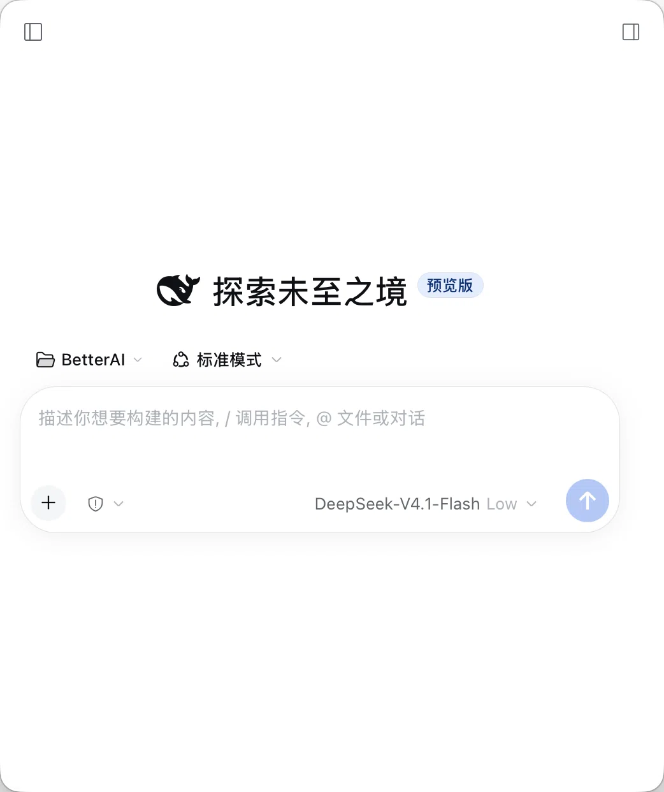
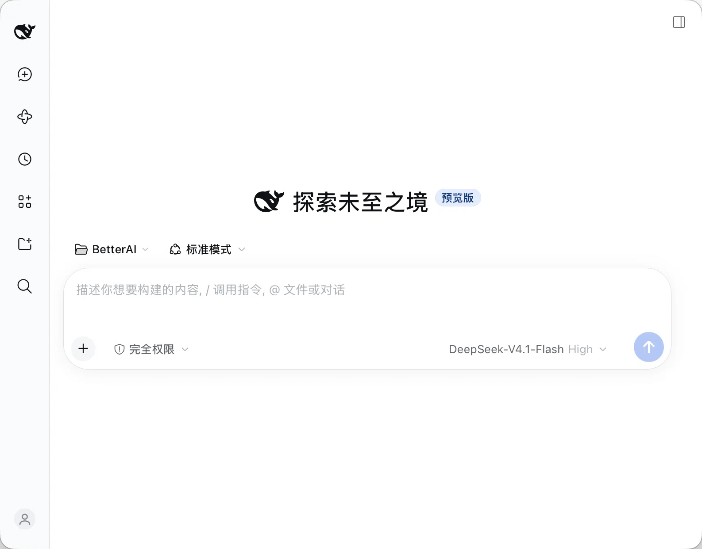

# Hotkey Popout (`@local/dsh-hotkey-popout`)

English | **[简体中文](README.md)**

A DeepSeek Harness plugin that puts a floating chat window one keystroke away,
from **any** app on the Mac.

Press **⌥ Space** → the window opens **on the screen your pointer is on**, over
whatever app is in front. Press it again, press `Esc`, click another app, or
switch windows → it disappears.

<p align="center">
  <a href="assets/popout.png"></a>
  <a href="assets/popout-wide.png"></a>
</p>

## Behaviour

| Action | Result |
| --- | --- |
| `⌥ Space` (system-wide) | Show the floating window on the screen with the mouse |
| `⌥ Space` again / `Esc` / click another app | Hide it |
| `⌘ N` while the window is focused | Start a new session (the app itself binds `⌥⌘N`) |
| `⌘ W` while the window is focused | Hide the popout |
| Hidden for ≥ `idleMinutes` (default 10) | The next summon starts a fresh session; the old conversation stays in the sidebar |
| Drag the top edge | Move the window; its **position** is remembered per display |
| Drag any edge or corner | Resize (minimum 360×320); the **size is shared** by every display |
| 📌 in the session header (left of the session menu) or `⌘⇧P` | Pin the window: it stops hiding on focus loss, so it can sit beside the main window |
| `Enter` / `Shift+Enter` | Send / newline |

The **idle clock starts when the window is hidden**, not when the last message
was sent: summon it at 09:00, hide it at 09:08, and it still restores that
conversation any time before 09:18. A session that never got a message is simply
reused instead of replaced.

The **remembered project** follows this window's own conversation: on hide it
reads which session this window shows and remembers its project. Activity in the
main window never affects it.

The window renders the Harness app itself, so Markdown, tool cards, approvals,
plan mode, attachments, slash commands and the model/permission pickers are all
native. Sessions created here appear in the sidebar and continue in the main
window like any other.

## Configuration

Override in the profile patch (`~/.dsh/profiles/<profile>/cordis.patch.yml`) or
in this package's `cordis.patch.yml`:

```yaml
- id: hotkey-popout
  name: '@local/dsh-hotkey-popout'
  config:
    hotkey: Option+Space   # Cmd+Shift+K, Ctrl+Alt+J, F13 … (modifiers + one key)
    idleMinutes: 10        # 0 disables the auto-new-session rule
    nativeWindow: true     # false disables the floating window entirely
    windowSize: 920x720    # initial floating window size in points
    globalHotkey: true
    helperPath: ''         # optional explicit path to the native helper
```

Invalid or missing values fall back to the defaults. The **Settings → General →
New session after idling** row edits `idleMinutes` through
`POST /hotkey-popout/settings`, which persists it to `~/.dsh/hotkey-popout.json`.

## Architecture

Two halves, plus a small native helper.

* **`native/hotkey-helper.swift`** — a single AppKit process that owns both
  pieces of the native experience:

  * it registers the Carbon hotkey (`RegisterEventHotKey`), which needs **no
    Accessibility or Input Monitoring permission** and fires while another app
    is frontmost;
  * it hosts a transparent, borderless `NSPanel` with a `WKWebView` that renders
    the Harness Web app in *window mode*. The panel is pre-warmed while hidden
    (so the first summon is instant), joins all Spaces (so it appears over
    full-screen apps), sits on the screen holding the mouse pointer, is dragged
    by its top strip, resized from every edge, and hides itself when it loses
    focus.

  The Swift source is authoritative: the Host reuses `bin/dsh-hotkey-helper-<arch>`
  only while it is at least as new as `native/hotkey-helper.swift`, and otherwise
  builds with `xcrun swiftc` into `~/Library/Caches/dsh-hotkey-popout/` (which
  keeps working when the package directory is read-only), falling back to `bin/`.
  Building needs the Xcode command line tools and takes ~2 s; the result is
  cached, so it happens once per source revision.

* **`index.js` (Host)** — owns the helper process and its JSON-line protocol,
  and serves the panel:

  * `GET /hotkey-popout/state` — config, helper status, projects, agent presets,
    permission presets;
  * `GET /hotkey-popout/wait?since=N` — long poll; a held request completes the
    instant the helper reports a hotkey press (a streaming response would be
    buffered by the server's gzip middleware, which is why this is a poll);
  * `GET /hotkey-popout/ping` — sequence head, for the fallback poll;
  * `POST /hotkey-popout/trigger` — `toggle-window`, `show-window`,
    `hide-window`, `reload-window`, or a bare toggle (tests and the window's own
    buttons);
  * `POST /hotkey-popout/settings` — writes `idleMinutes`;
  * `/hotkey-popout/client-log` — beacons from the page, used to verify rendering
    without a browser console.

  The helper starts only once the web server is listening, because the window
  needs the app's authenticated URL: on a cold boot the start is retried for up
  to a minute, and if the URL still is not available the helper starts without a
  window and upgrades itself once the URL appears. `state.helper.windowError`
  reports why a window was not used.

* **`client.js` (Client)** — one path only: inside the floating window it drives
  the real app (`uiWorkspace.openSession` / `startSession`); in the main window
  it registers the idle setting and the red warning shown when the helper is
  unavailable. The old self-drawn card was removed, so a profile without a
  working helper shows nothing.

### Why a native helper

The DSH Host runs as plain Node (`ELECTRON_RUN_AS_NODE=1`) under the Electron
main process, so `globalShortcut` and `BrowserWindow` are not reachable from a
plugin. A separate AppKit process is the smallest mechanism that yields a real
system-wide shortcut *and* a real window that can float on any Space.

## Window behaviour

The window shows the Harness app's own appearance, so light/dark follows the
app's settings.

Window geometry lives in `UserDefaults`: `dshp.window.frames` stores only an
origin per display id, while `dshp.window.size` stores one size for every
display. So a window dragged on the external monitor returns to that spot, and
resizing it once applies wherever it next opens.

## Limits

* macOS only. Without a working helper (another platform, no Xcode command line
  tools, or a failed build) the plugin renders nothing; **Settings → General**
  then shows a red line with the reason and the build command to run.
* The window renders the Web app in a second WebKit process, so it costs one
  extra page in memory. It is pre-warmed; the first summon still waits for the
  page's first load (~2 s after the plugin starts).
* The native helper is compiled on the user's machine, which requires the Xcode
  command line tools.
* The helper appears as its own accessory app while focused, so the menu bar
  briefly names `dsh-hotkey-helper-arm64`.
* After installing or changing the Client half, reload the app window once
  (`⌘ R`) so the settings row picks up the new bundle.
* The floating window is a second render of the Web app: it keeps its own
  session id in `localStorage` inside the WebView.

## Files

```
index.js                     Host plugin: helper lifecycle, routes, catalogs
client.js                    Client plugin: settings row, session summon, pin, shortcuts
cordis.patch.yml             Bundle patch inserting the plugin row
native/hotkey-helper.swift   macOS hotkey + floating window (source of truth)
bin/                         Generated helper binaries (gitignored; built on demand)
locale/{en,zh}.json          Plugin title and description
icon.svg                     Plugin icon
assets/popout*.png           README screenshots (click for full size)
```

## License

[MIT](LICENSE)
