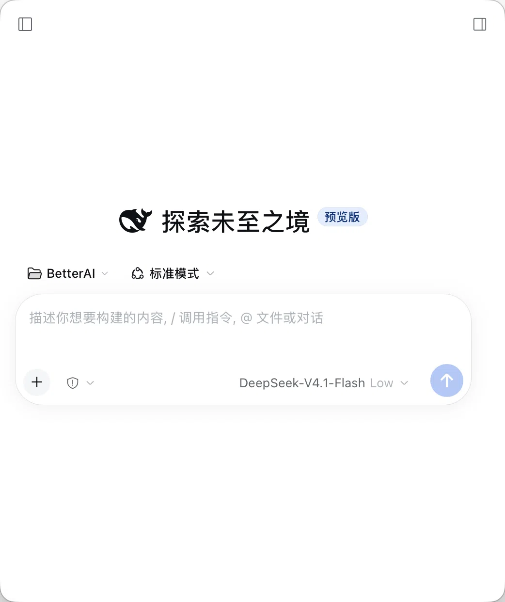

# DeepSeek Harness 悬浮窗插件（`@local/dsh-hotkey-popout`）

**English** | 简体中文

在 Mac 上用**一个快捷键**，从任何 App 里唤出 DeepSeek Harness 的悬浮对话窗。

按 **⌥ Space** → 窗口出现在**鼠标所在的那块屏幕**上，浮在当前 App 之上；再按一次、按 `Esc`、点击别的 App 或切换窗口，它就消失。



## 功能

| 操作 | 效果 |
| --- | --- |
| `⌥ Space`（系统全局） | 在鼠标所在屏幕唤出悬浮窗 |
| 再按 `⌥ Space` / `Esc` / 点击其他 App | 隐藏 |
| 聚焦窗口时 `⌘ N` | 新建会话（App 自身绑定的是 `⌥⌘N`） |
| 聚焦窗口时 `⌘ W` | 隐藏悬浮窗 |
| 隐藏时长 ≥ `idleMinutes`（默认 10 分钟） | 下次唤出自动新建会话，旧会话仍留在侧边栏 |
| 拖动顶部 | 移动窗口，**位置按屏幕分别记忆** |
| 拖动任意边或角 | 缩放（最小 360×320），**尺寸所有屏幕共用** |
| 会话标题栏的 📌（会话菜单左边）或 `⌘⇧P` | 固定窗口：失焦不再隐藏，可与主窗口并排使用 |
| `Enter` / `Shift+Enter` | 发送 / 换行 |

**闲置计时从「隐藏」开始算**，不是从最后一条消息算：09:00 唤出、09:08 隐藏，那么 09:18 之前再唤出，仍然恢复那段对话；一次都没发过消息的会话会被直接复用，不会浪费一个新会话。

**项目记忆**只跟随悬浮窗自己的对话：隐藏时读「这个窗口当前打开的是哪条会话」，记住它的项目；主窗口的活动不会影响它。

窗口里渲染的就是 Harness 本体，所以 Markdown、工具调用卡片、审批、plan 模式、附件、斜杠命令、模型/权限选择器全都是原生的。悬浮窗创建的会话会出现在侧边栏，可以回到主窗口继续聊。

## 配置

在 profile 补丁（`~/.dsh/profiles/<profile>/cordis.patch.yml`）或本包的 `cordis.patch.yml` 中覆盖：

```yaml
- id: hotkey-popout
  name: '@local/dsh-hotkey-popout'
  config:
    hotkey: Option+Space   # 例如 Cmd+Shift+K、Ctrl+Alt+J、F13（修饰键 + 一个按键）
    idleMinutes: 10        # 0 表示关闭「闲置自动新会话」
    nativeWindow: true     # false 表示不启用悬浮窗（插件将不起作用）
    windowSize: 920x720    # 悬浮窗初始尺寸（pt）
    globalHotkey: true
    helperPath: ''         # 可选：自定义 helper 可执行文件路径
```

非法或缺失的值会回退到默认值。**设置 → 通用 → 闲置后新会话** 也可以改 `idleMinutes`，写入 `~/.dsh/hotkey-popout.json`，立即生效。

## 工作原理

两部分 + 一个小的原生 helper。

* **`native/hotkey-helper.swift`** —— 一个 AppKit 进程，负责原生体验的两块：

  * 注册 Carbon 全局热键（`RegisterEventHotKey`），**不需要辅助功能/输入监控权限**，在其他 App 前台时也能触发；
  * 托管一个透明无边框的 `NSPanel`，里面是 `WKWebView`，以 *窗口模式* 渲染 Harness Web 应用。窗口在隐藏时预先加载（首次唤出即可见）、加入所有 Space（可覆盖全屏 App）、跟随鼠标所在屏幕、支持顶部拖拽和四边缩放、失焦自动隐藏。

  **Swift 源码是唯一事实来源**：只有当 `bin/dsh-hotkey-helper-<arch>` 比源码新时才会复用，否则用 `xcrun swiftc` 编译到 `~/Library/Caches/dsh-hotkey-popout/`（包目录只读时也能用），失败再回退到 `bin/`。编译需要 Xcode 命令行工具，约 2 秒，结果按源码版本缓存。

* **`index.js`（Host）** —— 负责 helper 进程与它的 JSON 行协议，并提供窗口所需的接口：

  * `GET /hotkey-popout/state` —— 配置、helper 状态、项目、agent preset、权限 preset；
  * `GET /hotkey-popout/wait?since=N` —— 长轮询；helper 一按键，挂起的请求立刻返回（流式响应会被服务的 gzip 中间件缓冲，所以用轮询）；
  * `GET /hotkey-popout/ping` —— 序列号，供兜底轮询；
  * `POST /hotkey-popout/trigger` —— `toggle-window` / `show-window` / `hide-window` / `reload-window`，或直接 toggle（用于测试与窗口按钮）；
  * `POST /hotkey-popout/settings` —— 写入 `idleMinutes`；
  * `/hotkey-popout/client-log` —— 面板上报的信标，用于无浏览器控制台时核验渲染。

  helper 只在 web server 开始监听后才启动，因为悬浮窗需要 App 的认证 URL：冷启动会重试最多一分钟；若仍拿不到，helper 以「无窗口」方式启动，并在 URL 出现后自动升级。原因会写在 `state.helper.windowError` 里。

* **`client.js`（Client）** —— 只有一条路径：悬浮窗页面里驱动真实 App 的导航（`uiWorkspace.openSession` / `startSession`），在主窗口里注册「闲置后新会话」设置项和 helper 不可用时的红字提示。旧的自绘卡片已移除，所以没有 helper 时插件不显示任何界面。

### 为什么需要原生 helper

DSH 的 Host 以纯 Node 方式运行（`ELECTRON_RUN_AS_NODE=1`）在 Electron 主进程下，插件拿不到 `globalShortcut` 和 `BrowserWindow`。一个独立的 AppKit 进程是用最小代价同时拿到**真正的系统级快捷键**和**可漂浮于任意 Space 的真实窗口**的方式。

## 窗口行为

窗口显示的是 Harness 自己的外观，所以深浅色由 App 的设置决定。

窗口几何存在 `UserDefaults`：`dshp.window.frames` 每个显示器只存原点，`dshp.window.size` 存一份所有屏幕共用的尺寸。于是副屏上拖到的位置会记住，而缩放一次后在任何屏幕都以这个大小打开。

## 限制

* 仅支持 macOS。helper 不可用时（其他平台、没装 Xcode 命令行工具、编译失败）插件不渲染任何东西，**设置 → 通用** 会显示红字说明原因和需要执行的编译命令。
* 窗口是第二份 WebKit 页面，会多占一份内存；已预先加载，首次唤出仍需等页面首次加载（插件启动后约 2 秒）。
* 原生 helper 在本机编译，需要 Xcode 命令行工具。
* helper 聚焦时会作为一个 accessory 应用出现在菜单栏，名字是 `dsh-hotkey-helper-arm64`。
* 安装或更新 Client 部分后，需刷新一次 App 窗口（`⌘ R`），设置项才会加载。
* 悬浮窗是 Web 应用的第二份渲染，它在 WebView 的 `localStorage` 里维护自己的会话 id。

## 文件

```
index.js                     Host 插件：helper 生命周期、路由、目录数据
client.js                    Client 插件：设置项、会话唤起、固定、快捷键
cordis.patch.yml             Bundle 补丁，插入插件行
native/hotkey-helper.swift   macOS 全局热键 + 悬浮窗（源码，唯一事实来源）
bin/                         生成的 helper 二进制（已 gitignore，按需编译）
locale/{en,zh}.json          插件名称与描述
icon.svg                     插件图标
assets/popout.png            README 截图
```

## License

[MIT](LICENSE)
